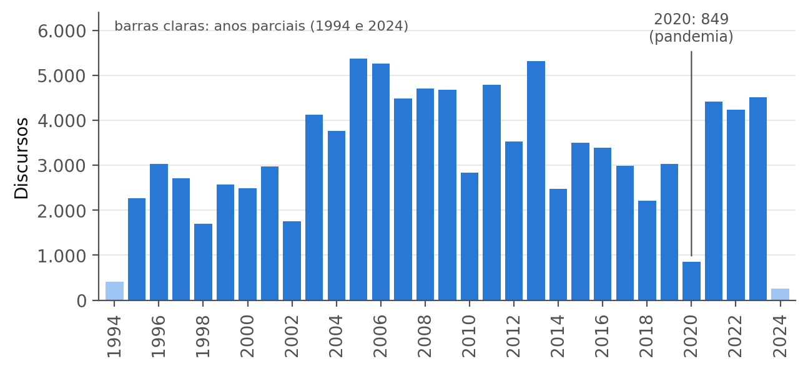
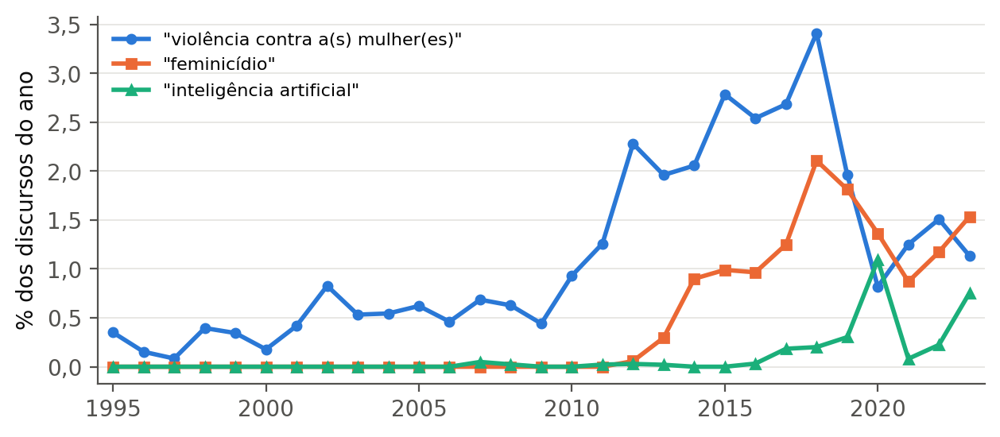

# AuditAI Senado: Transparência e Análise Parlamentar com IA

Projeto da disciplina **Inteligência Artificial** — 7º semestre de Ciência da Computação
Universidade Presbiteriana Mackenzie — Faculdade de Computação e Informática (FCI)
Professor: Prof. Dr. Ivan Carlos Alcântara de Oliveira — Turma 7º N
Repositório: <https://github.com/igorsa-hub/auditai-senado>

| Integrante | RA | E-mail |
|---|---|---|
| Julia Vitória Bomfim do Nascimento | 10425604 | 10425604@mackenzista.com.br |
| William Saran dos Santos Junior | 10420128 | 10420128@mackenzista.com.br |

## Sobre o projeto

O Senado Federal publica dezenas de milhares de discursos, mas o volume torna difícil saber **quais parlamentares abordam um tema e o que efetivamente disseram**. O AuditAI Senado será um **agente inteligente** que responde a perguntas em linguagem natural (ex.: *"Quais parlamentares mais abordaram violência contra a mulher?"*) usando **Processamento de Linguagem Natural, busca semântica (embeddings) e geração aumentada por recuperação (RAG)**: localiza os trechos de discursos relacionados ao tema, agrupa os resultados por parlamentar e apresenta os trechos como evidência, com ligação para a página oficial.

- **Área:** política, transparência pública, cidadania digital.
- **ODS 16 — Paz, Justiça e Instituições Eficazes** (metas 16.6 e 16.10: instituições transparentes e acesso público à informação).
- **Dados:** *Brazilian Senate Speeches* (Kaggle, CC BY-NC-SA 4.0) — ver [`dataset/README.md`](dataset/README.md).

## Status

| Etapa | Bimestre | Status |
|---|---|---|
| E1 Aquisição e caracterização do dataset | N1 | concluída |
| E2 Análise exploratória | N1 | concluída |
| E3 Preparação (limpeza, filtros, segmentação em trechos) | N1 | concluída |
| E4 Indexação (BM25 + vetorial) | N2 | concluída (notebook 03) |
| E5 Agente: ferramentas de recuperação e agrupamento por parlamentar | N2 | concluída (notebook 03); camada de LLM + RAG **não implementada** |
| E6 Interface web | N2 | **não implementada** |
| E7 Avaliação (classificação 10-fold; P@k, nDCG@10, MAP, MRR) | N2 | concluída como piloto com rótulos fracos (notebooks 02 e 03) |

## Estrutura do repositório

```
auditai-senado/
├── artigo/
│   ├── artigo_parcial_AuditAI_Senado.pdf     # artigo parcial (N1), template SBC
│   ├── artigo_final_AuditAI_Senado.pdf       # artigo final (N2), template SBC
│   └── latex/                                # artigo_parcial.tex, artigo_final.tex (N2), template SBC, figuras e referências
├── dataset/
│   ├── README.md                             # descrição do dataset, licença e como obtê-lo
│   └── amostra/                              # amostras dos dados preparados (CSV)
├── data/
│   ├── raw/                                  # partidos.json e externos.json (fsdb_lite.json: baixar do Kaggle)
│   └── processed/                            # bases preparadas (geradas pelo notebook; não versionadas)
├── notebooks/
│   ├── 01_analise_exploratoria_preparacao.ipynb   # N1: EDA + preparação
│   ├── 02_experimento_classificacao.ipynb         # N2: 7 classificadores, CV de 10 folds por autor
│   └── 03_experimento_recuperacao.ipynb           # N2: BM25 x densa (E5) x híbrida (RRF) + ferramentas do agente
├── estudos/
│   └── cancer_mama_parteIII/                 # material de estudo da disciplina (Mammographic Mass), não faz parte do projeto
├── docs/
│   └── Rubrica_IA_Parte3_N2_20262.docx       # rubrica de avaliação da N2
├── src/
│   ├── carregamento.py                       # leitura do JSON em streaming (ijson)
│   ├── preparacao.py                         # limpeza, filtros e segmentação em trechos
│   ├── preparar_base.py                      # gera data/processed/discursos.parquet (E1-E3 em script)
│   └── temas.py                              # temas, rótulos fracos e mascaramento dos termos
├── resultados/
│   ├── figuras/                              # gráficos (PNG e PDF); fig5 e fig6 são da N2
│   ├── tabelas/                              # tabelas da análise exploratória (CSV)
│   ├── classificacao/                        # resultados do experimento 1 (CSV e JSON)
│   ├── recuperacao/                          # resultados do experimento 2 (CSV)
│   ├── modelos/                              # melhor modelo de cada tema (joblib)
│   └── metricas.json                         # números da N1 citados no artigo
├── requirements.txt
└── README.md
```

## Como reproduzir

```bash
pip install -r requirements.txt
python -c "import nltk; nltk.download('stopwords')"
# baixe fsdb_lite.json do Kaggle para data/raw/ (ver dataset/README.md)
# torch (CPU), se ainda não instalado: pip install torch --index-url https://download.pytorch.org/whl/cpu
jupyter nbconvert --to notebook --execute --inplace notebooks/01_analise_exploratoria_preparacao.ipynb
python src/preparar_base.py        # gera data/processed/discursos.parquet (~1 min), exigido pelos notebooks 02 e 03
jupyter nbconvert --to notebook --execute --inplace notebooks/02_experimento_classificacao.ipynb   # ~12 min
jupyter nbconvert --to notebook --execute --inplace notebooks/03_experimento_recuperacao.ipynb     # ~15 min na CPU (embeddings)
```

A execução completa leva cerca de 5 minutos e usa até ~5 GB de RAM. Figuras, tabelas, `resultados/metricas.json` e as bases em `data/processed/` são regenerados.

## Principais resultados da N1

- **100.667** registros de **486** parlamentares; cobertura efetiva **1994 – mar/2024** (e não 1988–2024).
- **9,9%** dos registros sem texto autoral; **~18%** das palavras são de outros oradores → só o texto **Autoral** é indexado.
- `externos.json` inclui suplentes que foram senadores → **não** é usado como filtro.
- Busca literal por "violência contra a mulher": **815** discursos; com termos relacionados: **1.708** (+109,6%). "Feminicídio" só aparece com frequência a partir de 2013 (deriva de vocabulário) → justifica a busca semântica.
- Base final: **89.017** discursos → **558.569 trechos** (≤250 palavras, sobreposição de até 50) com autor, partido, data e URL.

| Discursos por ano | Evolução de termos |
|---|---|
|  |  |

## Principais resultados da N2

Tarefa com **rótulos fracos** (termos do tema) e os **termos removidos** do texto, para medir o sinal além da palavra literal.

| Experimento 1 (teste, autores não vistos) | F1 | Precisão | Revocação | AUC |
|---|---|---|---|---|
| Violência contra a mulher (regressão logística) | 0,830 | 0,768 | 0,902 | 0,965 |
| Meio ambiente (regressão logística) | 0,707 | 0,638 | 0,793 | 0,909 |

Experimento 2 (10 consultas, nDCG@10 médio): **densa 0,98**, híbrida 0,92, BM25 com termos removidos 0,77. A busca densa supera o BM25 sobretudo em meio ambiente; a híbrida (RRF) **não** superou a densa. **Limitações:** rótulos fracos, 10 consultas, amostra de 3.000 discursos, sem julgamento humano, sem camada de LLM e sem interface web. Detalhes no artigo final (`artigo/latex/artigo_final.tex`).

## Licença dos dados

Os dados derivados do *Brazilian Senate Speeches* (amostras em `dataset/amostra/` e arquivos auxiliares em `data/raw/`) seguem a licença **CC BY-NC-SA 4.0** do conjunto original (LicoLabres, 2024).
